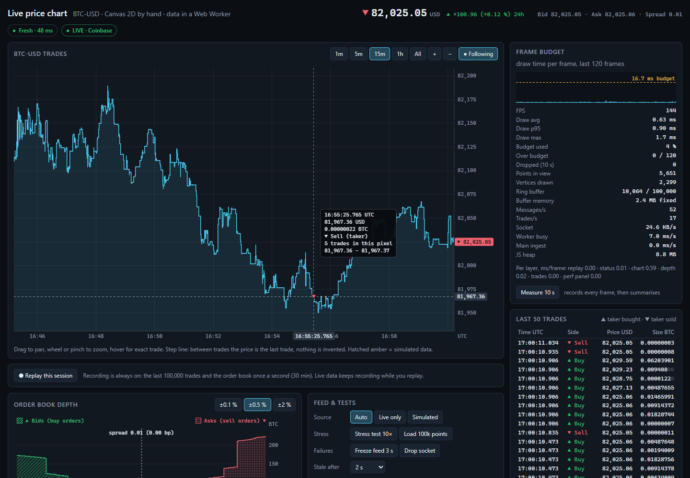
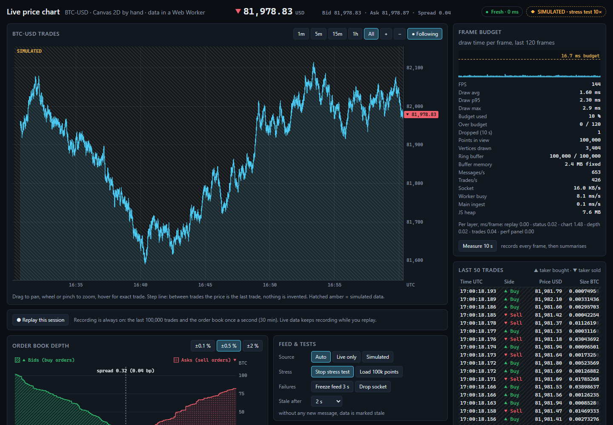
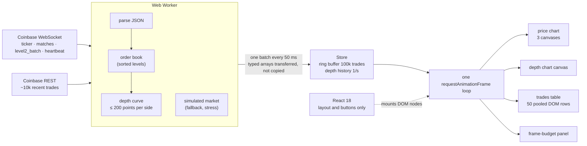
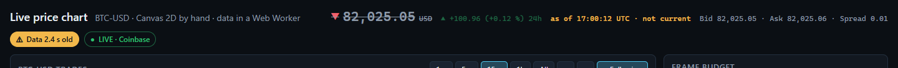
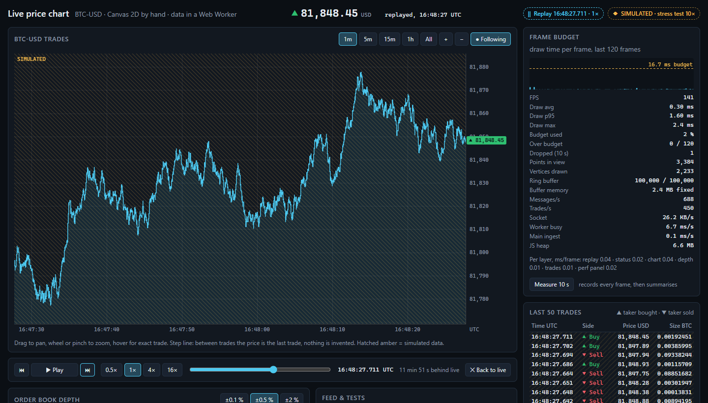
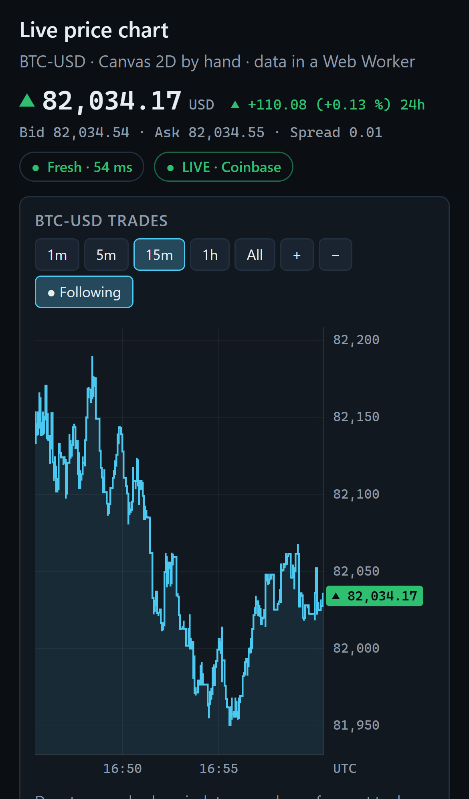

# Live Price Chart

A live BTC-USD trading screen drawn by hand on Canvas 2D: no chart library. Market data
streams from Coinbase into a Web Worker, the UI draws in one animation loop with a measured
frame budget, the whole session can be replayed, and the screen tells you when its data is old.

**Live demo: https://danielyan99.github.io/live-price-chart/**



## What it shows

| Requirement of a trading dashboard | Where to see it                                           | How it is done                                                                                                                                         |
| ---------------------------------- | --------------------------------------------------------- | ------------------------------------------------------------------------------------------------------------------------------------------------------ |
| Charts drawn by hand               | Price chart, depth chart, frame sparkline                 | Canvas 2D only. Price chart = 3 stacked canvases (grid, series, crosshair), sized for `devicePixelRatio`.                                              |
| Thousands of streaming points      | Chart opens with ~10,000 real trades, holds up to 100,000 | Ring buffer of typed arrays, min/max downsampling per pixel column.                                                                                    |
| Frame budget                       | **Frame budget** panel, **Measure 10 s** button           | One `requestAnimationFrame` loop; every frame's draw time is measured against 16.7 ms.                                                                 |
| Replay                             | **Replay this session** under the chart                   | Recording is always on. Play, pause, step trade by trade, scrub, 0.5× / 1× / 4× / 16×.                                                                 |
| Numbers shown correctly            | Trades table, axes, crosshair, header                     | Decimal rounding (not binary), prices and sizes aligned on the decimal point, real minus sign, UTC times, axis labels that cannot repeat.              |
| Honest under load                  | Stale badge, line ends early, `SIMULATED` bands           | Data age is measured; old prices are struck through and labelled "as of"; simulated data is hatched and labelled, never mixed silently with real data. |
| Readable without colour            | Everywhere                                                | Up/down also by ▲ / ▼ and words; bids hatched, asks dotted; over-budget frames hatched.                                                                |
| Stress test                        | **Stress test 10×**, **Load 100k points**                 | Simulated feed at 10× the message rate (about 600 messages/s), numbers in the panel.                                                                   |

## Measured performance

`npm run measure` builds the app, serves the production build, sets up each scenario through
the real UI and records every animation frame for 10 seconds (`window.__lpc.measure`).
Raw results: [docs/measurements.md](docs/measurements.md), [docs/measurements.json](docs/measurements.json).

Measured 2026-10-15 on Intel Core i5-14400, NVIDIA RTX 4070 SUPER (Chrome GPU raster), Chrome 154
headless, 1440×900. "CPU slowdown" is Chrome DevTools CPU throttling, to approximate slower
laptops (4×) and low-end phones (6×).

| Scenario                        | CPU slowdown | Points in view | Feed msg/s | FPS | Draw avg | Draw p95 | Draw p99 | Frames over 16.7 ms |
| ------------------------------- | ------------ | -------------- | ---------- | --- | -------- | -------- | -------- | ------------------- |
| Live feed, 15 min view          | none         | 5,727          | 22         | 143 | 0.70 ms  | 1.50 ms  | 2.20 ms  | 0 / 1428            |
| Live feed, all history in view  | none         | 10,164         | 16         | 144 | 1.08 ms  | 2.10 ms  | 2.70 ms  | 0 / 1440            |
| Live feed, all history in view  | 4×           | 10,276         | 20         | 126 | 3.17 ms  | 4.70 ms  | 6.80 ms  | 0 / 1270            |
| Stress 10×, 100k points in view | none         | 100,000        | 609        | 143 | 2.18 ms  | 3.90 ms  | 5.10 ms  | 0 / 1429            |
| Stress 10×, 100k points in view | 4×           | 100,000        | 592        | 56  | 8.48 ms  | 13.20 ms | 16.40 ms | 4 / 582             |
| Stress 10×, 100k points in view | 6×           | 100,000        | 619        | 16  | 19.15 ms | 28.00 ms | 31.00 ms | 103 / 176           |
| Stress 10×, 5 min view          | 6×           | 32,354         | 627        | 29  | 10.30 ms | 17.60 ms | 21.00 ms | 28 / 303            |
| Replay 16×, 5 min view          | none         | 3,613          | 633        | 140 | 0.87 ms  | 2.20 ms  | 4.00 ms  | 0 / 1405            |

In short:

- **100,000 points on screen with the feed at 10× runs at the display's full 144 FPS, 2.2 ms
  average draw, 0 frames over budget.**
- With a 4× slower CPU it still holds about 60 FPS (56 to 62 FPS across runs).
- On a 6× slower CPU (a low-end phone) the 100k stress view does **not** hold 60 FPS: 16 to 29
  FPS. Normal live data at 4× slowdown stays above 120 FPS.

How to read the columns: **FPS** is real animation frames per second (the test display runs at
144 Hz, so 144 is the maximum). **Draw** is the JavaScript time of one frame, including issuing
the canvas commands; the browser's own layout, paint and GPU work are not in it, but they are in
FPS. The budget line is 16.7 ms (60 FPS).

### What measuring changed

Two fixes came from measurements, not guesses:

1. **Stroking the dense line was the bottleneck, not my code.** With 100k points the JS draw
   time was only ~3 ms, yet FPS stayed near 50-64. Hiding layers one by one showed the line
   stroke was the cost: Chrome's GPU stroker is slow on one long path that overlaps itself.
   When there are more points than pixels, the chart now draws one bar per pixel column
   (from the column's low to its high, including the step from the previous price). These are
   the same pixels, but as a few hundred plain rectangles. **Full CPU: ~50-64 → 144 FPS.**
2. **Rewriting the trades table every frame cost layout and paint.** A Chrome trace at 4×
   slowdown showed ~285 ms of layout per second. The table now refreshes at most 10 times a
   second (the chart still shows every trade), text nodes are updated in place, and panels use
   CSS containment so a text change never re-lays out the page. With a faster bulk loop in the
   downsampler: **4× slowdown: 19 → ~60 FPS.**



## Architecture



- **Data never draws.** A worker batch only lands in the store and bumps version counters. In
  the next frame each view compares versions and redraws only if something it shows changed.
- **No React render per tick.** React renders the page structure and the controls. Canvases and
  the numbers in the trades table, header and panels are written by the frame loop. React
  re-renders only when a button state changes (source, replay on/off, speed...).
- **Memory stays flat.** Trades live in a fixed `PointRing` (four typed arrays, 100,000 slots,
  2.4 MB). When it is full, the oldest trade is overwritten.

## How the hard parts work

**Downsampling that keeps spikes.** Points are put into pixel columns by time. For each column
only the first, lowest, highest and last point are kept (the "M4" idea), so a one-trade spike is
still visible at 1,000 trades per pixel. With fewer points than pixels, every point is drawn.
The line is a **step line**: between two trades the price is the last trade, nothing is
interpolated. Hovering shows the exact trade under the cursor, and if one pixel holds many
trades, how many and their real price range.

**Axes that do not lie.** Price ticks are 1, 2, 2.5 or 5 × 10ⁿ, never finer than the $0.01
price increment, and the label precision comes from the step, so two ticks can never print the
same label (tested over 2,000 random ranges). Time ticks are whole UTC steps, the axis says
`UTC`, and a tick at midnight shows the date.

**Numbers.** `1.005` rounds to `1.01` (rounding on the decimal digits, not the binary value that
`toFixed` uses). Negative values use a real minus sign, `-0.00` is never shown. In the trades
table each number is split at the decimal point: the integer part is right-aligned, the fraction
left-aligned, and trailing zeros are dimmed. So `0.5` and `0.12345678` line up on the point.

**Stale data.** The worker stamps each batch with the local time the newest _market_ message
arrived (trade, ticker, book change). A Coinbase heartbeat counts only if we already have the
trade it names, so missing trades can never look fresh. When the age passes the threshold
(default 2 s), the badge says for example "Data 2.4 s old", the price is struck through and
labelled "as of 17:00:12 UTC · not current", the depth chart says the book is not updating, and
the price line stops where the known data stops.



The real feed needs this. In a 60 s sample, Coinbase sent nothing for more than 1 s fourteen
times, and once for 27.5 s (heartbeats included). Use **Freeze feed 3 s** to see it on demand.

**Live, fallback and honesty about the source.** In _Auto_ mode the app connects to Coinbase.
If the socket fails, is silent for 8 s, or Coinbase refuses the trades channel (it limits
subscriptions per IP and answers "subscription limit reached"), the built-in simulator takes
over within one batch, starting from the last real price. The app reconnects with backoff
(2 s up to 30 s) and switches back when live data flows. Simulated trades carry a flag, so the
chart hatches and labels those ranges `SIMULATED`, the trades table hatches those rows, and the
header shows which source is active. **Drop socket** tests this on demand.

**Replay.** Every view reads "now" from one clock. Live, that is the exchange time. In replay it
is the cursor, so the chart, trades table, depth chart (from the order book recorded once a
second) and header all move together, while live data keeps recording in the background.



**Exchange clock.** The chart's right edge is exchange time, estimated from message times
(the largest _message time − receive time_ over the last 10 s). So a computer clock that is a
few seconds off does not hide the newest trades.

## Phone

The layout is one column on narrow screens. The chart supports touch: drag to pan, pinch to
zoom, tap for the crosshair.



## Run it

```bash
npm install
npm run dev           # http://localhost:5173
npm test              # 87 unit tests (Vitest)
npm run typecheck     # TypeScript strict
npm run lint          # oxlint
npm run measure       # performance table above (needs Google Chrome installed)
npm run screenshots   # images in docs/
```

## Tests

87 unit tests in 11 files, for the logic the screen depends on:

- `ringBuffer` – wrap-around, size limit, flat memory, binary search across the wrap
- `format` – decimal rounding, minus sign, decimal-point alignment, UTC time, durations
- `ticks` – nice steps, unique labels over 2,000 random ranges, UTC alignment
- `downsample` – min and max kept per column, spikes survive, sparse pass-through, bulk loop equals the simple one
- `orderBook` – sorted levels under random updates, depth curve totals
- `coinbase` – message parsing, maker vs taker side, refused channels
- `simulator` – deterministic, Poisson rate, book never crossed
- `store`, `replay`, `perfStats`, `staleness`

## Honest limits

- The numbers above are from one fast desktop. CPU throttling approximates slower devices; it is
  not a real phone.
- On a 6× slower CPU the 100k-point stress view runs below 60 FPS (table above).
- The trades table refreshes at most 10 times a second by design; the chart shows every trade.
- The depth curve is sampled to at most 200 points per side. Every point is exact; only the steps
  between points are simplified.
- The order book is recorded once a second for 30 minutes. The ~10k trades loaded at start come
  from the REST API, so there is no recorded book for that time (replay says so).
- Coinbase limits subscriptions per IP. Many open tabs on one network can hit it; the app then
  falls back to simulated data and shows the reason.

## Stack

React 18, TypeScript (strict), Vite, Vitest, Canvas 2D, Web Worker. Playwright only for the
measurement and screenshot scripts. Deployed to GitHub Pages with GitHub Actions. No chart
library, no UI library. Market data: Coinbase Exchange public feed (no API key).
